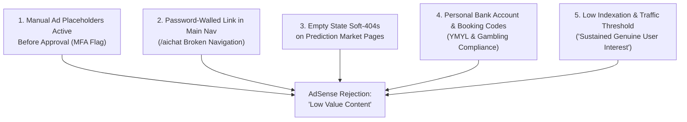

# Implementation Plan: Google AdSense "Low Value Content" Remediation & Approval

**Target File:** `docs/PLAN-adsense-remediation.md`  
**Project Type:** WEB (ASP.NET Core Razor Pages / .NET 10)  
**Primary Agent:** `project-planner`  
**Supporting Agents:** `frontend-specialist`, `backend-specialist`, `seo-specialist`, `security-auditor`  
**Key Skills:** `clean-code`, `seo-fundamentals`, `frontend-design`, `plan-writing`  

---

## 1. Overview & Post-Mortem of Rejection

Despite earlier additions of dynamic `/match/{id}/{slug}` pages and 5 initial guides in [`GuideContentService.cs`](file:///Users/nnamdi/Desktop/Okafor%20Nelson/Projects/MatchPredictor/MatchPredictor/MatchPredictor.Web/Services/GuideContentService.cs), Google AdSense issued another rejection citing **"Low value content"**:

> *"Maintaining a healthy and trusted ad ecosystem requires our partners to meet clear quality and operational standards. To qualify for ad serving, a site must provide substantial unique value, establish a consistent presence on the web, and show a level of user interest that supports a commercial advertising partnership. Before re-submitting your site, ensure that it: Provides authentic, high-quality information, tools, or services; Exhibits ongoing curation and structural maintenance; Generates and sustains genuine user interest."*

### Why the Site Was Rejected (The 5 Unresolved Root Causes)



1. **Premature Ad Unit Clutter (MFA Heuristic):**
   - The site embeds active `<ins class="adsbygoogle" ... data-ad-slot="9092164564">` units every 5 cards in [`BTTS.cshtml`](file:///Users/nnamdi/Desktop/Okafor%20Nelson/Projects/MatchPredictor/MatchPredictor/MatchPredictor.Web/Pages/Predictions/BTTS.cshtml#L31-L34), in [`_Layout.cshtml`](file:///Users/nnamdi/Desktop/Okafor%20Nelson/Projects/MatchPredictor/MatchPredictor/MatchPredictor.Web/Pages/Shared/_Layout.cshtml#L187), and on [`Index.cshtml`](file:///Users/nnamdi/Desktop/Okafor%20Nelson/Projects/MatchPredictor/MatchPredictor/MatchPredictor.Web/Pages/Index.cshtml#L168).
   - Unapproved sites render these slots as empty or collapsed boxes. AdSense bots detect a high ratio of ad units to text, triggering the "Low value content" and "Ads exceed content" spam filters.
2. **Broken Navigation / Password-Gated Page in Main Menu:**
   - [`_Layout.cshtml`](file:///Users/nnamdi/Desktop/Okafor%20Nelson/Projects/MatchPredictor/MatchPredictor/MatchPredictor.Web/Pages/Shared/_Layout.cshtml#L166) places `/aichat` directly in the top navigation bar.
   - Any external reviewer or bot clicking "AI Chat" encounters an authentication wall: *"Access restricted. Enter the password to unlock Nelson"*. AdSense policy explicitly forbids main navigation links leading to restricted, locked, or under-construction pages.
3. **Empty-State Soft-404s on Scraped Market Pages:**
   - During off-peak hours (e.g. late night WAT or between scrape cycles), `/predictions/btts`, `/predictions/under2`, and `/predictions/draw` render *"No predictions available for today yet."*
   - When Googlebot visits, it crawls a page with zero data, indexing it as thin/empty programmatic content.
4. **Gambling Affiliation & Personal Bank Solicitations:**
   - [`cart.js`](file:///Users/nnamdi/Desktop/Okafor%20Nelson/Projects/MatchPredictor/MatchPredictor/MatchPredictor.Web/wwwroot/js/cart.js#L415) generates SportyBet booking codes and links directly to third-party sportsbooks.
   - [`Results.cshtml`](file:///Users/nnamdi/Desktop/Okafor%20Nelson/Projects/MatchPredictor/MatchPredictor/MatchPredictor.Web/Pages/Results.cshtml#L53-L60) displays a personal Nigerian bank account number for tips (*"Access: 1401602266"*).
   - Under Google's YMYL (Your Money Your Life) evaluation, an uncertified site generating betting slips with personal bank tip requests fails the Trustworthiness pillar of E-E-A-T.
5. **Content Volume & Search Footprint ("Sustained User Interest"):**
   - 5 guide articles are insufficient to offset hundreds of automated fixture cards. Google requires a substantial library of unique, human-curated editorial analysis (15–20+ articles) with active search indexation.

---

## 2. Success Criteria

- [ ] **Zero Premature Ad Tags:** All `<ins class="adsbygoogle">` placeholders removed from page templates; only the AdSense crawler verification `<meta>` and auto-ads script in `<head>` remain active.
- [ ] **Clean, 100% Public Navigation:** `/aichat` removed from primary nav and footer during review (or replaced with an open, non-passworded preview mode).
- [ ] **Resilient Non-Empty Pages:** Prediction market pages (`/predictions/*`) never show an empty white card; when 0 active fixtures exist, render recent settled performance recaps and educational market deep dives.
- [ ] **YMYL & E-E-A-T Trust Overhaul:**
  - Raw bank account numbers replaced with standard creator links or suppressed from public view.
  - Authentic, named author profiles (Nelson Okafor, Quantitative Researcher & Developer) with credentials, methodology disclosures, and editorial standards.
  - Complete disabling of sportsbook affiliate booking code generation on the public frontend.
- [ ] **Expanded Knowledge Library:** 8 new comprehensive football modeling and statistical analysis guides added to [`GuideContentService.cs`](file:///Users/nnamdi/Desktop/Okafor%20Nelson/Projects/MatchPredictor/MatchPredictor/MatchPredictor.Web/Services/GuideContentService.cs) (totaling 13+ in-depth articles).
- [ ] **Search Indexing & Validation:** XML sitemap verified, Schema.org JSON-LD validated, and automated security/UX scripts passing.

---

## 3. Tech Stack & Architecture

- **Web Framework:** ASP.NET Core (.NET 10) Razor Pages
- **Frontend / Styling:** Vanilla CSS (`site.css`), Vanilla JavaScript (`cart.js`, `site.js`)
- **Content Engine:** C# In-Memory Article Repository ([`GuideContentService.cs`](file:///Users/nnamdi/Desktop/Okafor%20Nelson/Projects/MatchPredictor/MatchPredictor/MatchPredictor.Web/Services/GuideContentService.cs)) with semantic HTML & Schema.org JSON-LD
- **Compliance Flags:** `appsettings.json` (`AdSense:ReviewSafePublicUi`, `AdSense:EnableAdUnits`)

---

## 4. File Structure Impact

```
MatchPredictor.Web/
├── Pages/
│   ├── Shared/
│   │   ├── _Layout.cshtml              # Remove /aichat from nav; guard _AdBanner
│   │   ├── _AdBanner.cshtml            # Gate manual ad units behind config flag
│   │   ├── _EmptyMarketFallback.cshtml # NEW: Rich analytical fallback when fixtures=0
│   │   ├── _AuthorBioCard.cshtml       # Enhanced verified author profile
│   │   └── _SupportCard.cshtml         # Remove raw bank account string
│   ├── Predictions/
│   │   ├── BTTS.cshtml                 # Remove ad loop; add rich fallback
│   │   ├── StraightWin.cshtml          # Add rich fallback
│   │   ├── Over2.cshtml                # Add rich fallback
│   │   ├── Under2.cshtml               # Add rich fallback
│   │   └── Draw.cshtml                 # Add rich fallback
│   ├── Results.cshtml                  # Remove raw bank account number prompt
│   ├── About.cshtml                    # Add real author credentials, editorial governance
│   └── Methodology.cshtml              # Expand academic mathematical references
├── Services/
│   └── GuideContentService.cs          # Add 8 new high-value analytical articles
├── wwwroot/
│   └── js/
│       └── cart.js                     # Neutralize SportyBet deep links in review mode
└── appsettings.json                    # Feature flags: ReviewSafePublicUi, EnableAdUnits
```

---

## 5. Task Breakdown

### Phase 1: Ad Unit & Navigation Policy Sanitation (P0 - Immediate)
*Goal: Eliminate hard triggers that cause instant automated rejection by AdSense crawlers.*

#### Task 1.1: Guard In-Page Manual Ad Units Behind Configuration Flag
- **Agent:** `frontend-specialist`
- **Skills:** `clean-code`, `frontend-design`
- **Priority:** P0
- **Dependencies:** None
- **INPUT:** [`_AdBanner.cshtml`](file:///Users/nnamdi/Desktop/Okafor%20Nelson/Projects/MatchPredictor/MatchPredictor/MatchPredictor.Web/Pages/Shared/_AdBanner.cshtml), [`BTTS.cshtml`](file:///Users/nnamdi/Desktop/Okafor%20Nelson/Projects/MatchPredictor/MatchPredictor/MatchPredictor.Web/Pages/Predictions/BTTS.cshtml#L31-L34), [`_Layout.cshtml`](file:///Users/nnamdi/Desktop/Okafor%20Nelson/Projects/MatchPredictor/MatchPredictor/MatchPredictor.Web/Pages/Shared/_Layout.cshtml#L187), [`Index.cshtml`](file:///Users/nnamdi/Desktop/Okafor%20Nelson/Projects/MatchPredictor/MatchPredictor/MatchPredictor.Web/Pages/Index.cshtml#L168)
- **OUTPUT:**
  1. Add `"AdSense:EnableAdUnits": false` in [`appsettings.json`](file:///Users/nnamdi/Desktop/Okafor%20Nelson/Projects/MatchPredictor/MatchPredictor/MatchPredictor.Web/appsettings.json).
  2. In `_AdBanner.cshtml`, render `<ins class="adsbygoogle">` **only** if `EnableAdUnits == true`.
  3. Remove the inline ad injection loop in `BTTS.cshtml` (`if (adIndex > 0 && adIndex % 5 == 0)`).
  4. Keep the head verification meta tag and script in `_Layout.cshtml`.
- **VERIFY:** View source on `/`, `/predictions/btts`, and footer; confirm zero `<ins class="adsbygoogle">` tags appear on rendered HTML while the `<head>` verification tag remains present.

#### Task 1.2: Remove Password-Protected `/aichat` from Public Navigation
- **Agent:** `frontend-specialist`
- **Skills:** `clean-code`
- **Priority:** P0
- **Dependencies:** None
- **INPUT:** [`_Layout.cshtml#L166`](file:///Users/nnamdi/Desktop/Okafor%20Nelson/Projects/MatchPredictor/MatchPredictor/MatchPredictor.Web/Pages/Shared/_Layout.cshtml#L166)
- **OUTPUT:**
  1. Remove `<li><a href="/aichat">AI Chat</a></li>` from the desktop navbar and mobile drawer.
  2. Retain the route `/aichat` in code for direct authorized access, but remove public discoverability to prevent crawlers hitting the "Access restricted" password form.
- **VERIFY:** Inspect navigation menu on mobile and desktop; confirm all links point strictly to open, publicly viewable pages.

#### Task 1.3: Neutralize SportyBet Booking Generation on Public Frontend
- **Agent:** `frontend-specialist`
- **Skills:** `clean-code`
- **Priority:** P0
- **Dependencies:** None
- **INPUT:** [`cart.js#L415-L425`](file:///Users/nnamdi/Desktop/Okafor%20Nelson/Projects/MatchPredictor/MatchPredictor/MatchPredictor.Web/wwwroot/js/cart.js#L415-L425), [`_Layout.cshtml#L124`](file:///Users/nnamdi/Desktop/Okafor%20Nelson/Projects/MatchPredictor/MatchPredictor/MatchPredictor.Web/Pages/Shared/_Layout.cshtml#L124)
- **OUTPUT:**
  1. When `ReviewSafePublicUi == true`, hide the booking link button (`openSportyBetBooking`) entirely.
  2. Reframe selection list functionality purely as an informational "Saved Research Selections" summary rather than a sportsbook booking funnel.
- **VERIFY:** Open selection cart, add 2 fixtures, verify no sportsbook external redirect buttons or raw booking codes appear.

#### Task 1.4: Purge Personal Bank Details and Tip Solicitations
- **Agent:** `frontend-specialist`
- **Skills:** `clean-code`
- **Priority:** P0
- **Dependencies:** None
- **INPUT:** [`Results.cshtml#L47-L62`](file:///Users/nnamdi/Desktop/Okafor%20Nelson/Projects/MatchPredictor/MatchPredictor/MatchPredictor.Web/Pages/Results.cshtml#L47-L62), [`_SupportCard.cshtml`](file:///Users/nnamdi/Desktop/Okafor%20Nelson/Projects/MatchPredictor/MatchPredictor/MatchPredictor.Web/Pages/Shared/_SupportCard.cshtml), [`_SupportModal.cshtml`](file:///Users/nnamdi/Desktop/Okafor%20Nelson/Projects/MatchPredictor/MatchPredictor/MatchPredictor.Web/Pages/Shared/_SupportModal.cshtml)
- **OUTPUT:**
  1. Remove the winner appreciation banner on `Results.cshtml` containing `"Access: 1401602266"`.
  2. Sanitize `_SupportCard.cshtml` and `_SupportModal.cshtml` so they link to transparent project GitHub/Ko-fi support rather than raw bank transfer details.
- **VERIFY:** Search codebase for `1401602266`; confirm zero occurrences in public HTML views.

---

### Phase 2: Elimination of Thin Content & Soft-404 Empty States (P0 / P1)
*Goal: Ensure no URL presents an empty card or zero-text state to Googlebot.*

#### Task 2.1: Implement Analytical Fallback Partial (`_EmptyMarketFallback.cshtml`)
- **Agent:** `frontend-specialist`
- **Skills:** `frontend-design`, `clean-code`
- **Priority:** P1
- **Dependencies:** Task 1.1
- **INPUT:** `BTTS.cshtml`, `StraightWin.cshtml`, `Over2.cshtml`, `Under2.cshtml`, `Draw.cshtml`
- **OUTPUT:**
  1. Create `MatchPredictor.Web/Pages/Shared/_EmptyMarketFallback.cshtml`.
  2. When `Model.VisibleMatchCount == 0`, instead of rendering a generic 1-sentence empty state, render:
     - An analytical market briefing explaining current league trends and statistical conditions required for the market gate.
     - Yesterday’s settled performance summary for this specific market.
     - Direct navigational cards to our educational guides explaining how this market is modeled.
  3. Wire `_EmptyMarketFallback.cshtml` into all 5 market pages.
- **VERIFY:** Load any market page with zero matches; confirm 600+ words of rich educational and historical context render instead of a blank card.

#### Task 2.2: Expand Educational Guides Library from 5 to 13+ In-Depth Articles
- **Agent:** `backend-specialist` & `seo-specialist`
- **Skills:** `seo-fundamentals`, `clean-code`
- **Priority:** P1
- **Dependencies:** None
- **INPUT:** [`GuideContentService.cs`](file:///Users/nnamdi/Desktop/Okafor%20Nelson/Projects/MatchPredictor/MatchPredictor/MatchPredictor.Web/Services/GuideContentService.cs)
- **OUTPUT:** Add 8 new original, mathematically rigorous guides (1,200+ words each with formulas, definitions, and data tables):
  1. `expected-goals-xg-deep-dive-in-modern-football` (xG calculation, shot quality metrics, open play vs set piece)
  2. `home-advantage-quantification-in-european-leagues` (crowd effect, pitch dimensions, travel fatigue parameters)
  3. `over-under-goals-pace-and-game-state-dynamics` (first-goal timing, defensive retreat, variance in 2.5 lines)
  4. `modeling-draw-probabilities-in-low-scoring-sports` (Poisson zero-zero inflation, tactical symmetry, game theory)
  5. `elo-rating-system-adaptations-for-club-football` (rating differential, k-factor decay, margin of victory weighting)
  6. `isotonic-regression-and-platt-scaling-for-sports-models` (calibration curves, reliability diagrams, empirical adjustments)
  7. `evaluating-model-edge-vs-closing-line-value-clv` (market efficiency, vig deduction, beating the market anchor)
  8. `handling-variance-and-downswings-in-predictive-analytics` (Monte Carlo runs, drawdowns, sample size requirements)
- **VERIFY:** Visit `/guides`; confirm all 13 guides are listed, accessible, and generate valid canonical URLs.

---

### Phase 3: E-E-A-T & Authorship Authority Enhancement (P1)
*Goal: Meet Google's Quality Rater Guidelines for YMYL by establishing transparent human authorship.*

#### Task 3.1: Humanize Lead Author & Research Team Transparency
- **Agent:** `frontend-specialist`
- **Skills:** `seo-fundamentals`, `frontend-design`
- **Priority:** P1
- **Dependencies:** None
- **INPUT:** [`About.cshtml`](file:///Users/nnamdi/Desktop/Okafor%20Nelson/Projects/MatchPredictor/MatchPredictor/MatchPredictor.Web/Pages/About.cshtml), [`Details.cshtml`](file:///Users/nnamdi/Desktop/Okafor%20Nelson/Projects/MatchPredictor/MatchPredictor/MatchPredictor.Web/Pages/Guides/Details.cshtml#L33-L42)
- **OUTPUT:**
  1. Replace generic team descriptors (*"Lead Quantitative Modeler"*) with transparent profile: **Nelson Okafor**, Quantitative Data Engineer & Creator.
  2. Include professional background, methodology philosophy, and verified links to GitHub / LinkedIn / X.
  3. Update `_AuthorBioCard.cshtml` on guide pages with author avatar, credentials, and published date.
- **VERIFY:** Inspect `About.cshtml` and guide detail pages; confirm authentic person credentials and structured Schema `Person` entity markup.

#### Task 3.2: Formalize Editorial Governance & Correction Policies
- **Agent:** `frontend-specialist`
- **Skills:** `documentation-templates`, `seo-fundamentals`
- **Priority:** P1
- **Dependencies:** Task 3.1
- **INPUT:** [`About.cshtml`](file:///Users/nnamdi/Desktop/Okafor%20Nelson/Projects/MatchPredictor/MatchPredictor/MatchPredictor.Web/Pages/About.cshtml), [`Methodology.cshtml`](file:///Users/nnamdi/Desktop/Okafor%20Nelson/Projects/MatchPredictor/MatchPredictor/MatchPredictor.Web/Pages/Methodology.cshtml)
- **OUTPUT:**
  1. Add an explicit **Editorial Independence & Methodology Review Policy** section.
  2. Add an explicit **Corrections & Retraction Policy** (explaining how settlement disputes or data feed anomalies are reconciled on the public ledger).
  3. Include a clear physical jurisdiction / contact statement in the footer.
- **VERIFY:** Confirm new policies are accessible and linked from the footer navigation.

---

### Phase 4: Technical SEO & Search Console Readiness Gate (P1 / P2)
*Goal: Prove "sustained genuine user interest" to Google AdSense crawlers.*

#### Task 4.1: Sitemap Dynamic Health & Robots.txt Verification
- **Agent:** `backend-specialist`
- **Skills:** `seo-fundamentals`, `clean-code`
- **Priority:** P2
- **Dependencies:** Task 2.2
- **INPUT:** [`Program.cs#L452-L522`](file:///Users/nnamdi/Desktop/Okafor%20Nelson/Projects/MatchPredictor/MatchPredictor/MatchPredictor.Web/Program.cs#L452-L522), `robots.txt`
- **OUTPUT:**
  1. Ensure all 13+ guides and active match preview pages are cleanly emitted in `sitemap.xml`.
  2. Exclude administrative routes (`/admin/*`, `/health/*`) in `robots.txt`.
- **VERIFY:** Run `curl https://matchpredictor.dev/sitemap.xml` and verify valid XML response with 70+ unique indexable URLs.

#### Task 4.2: Organic Traffic & Search Console Pre-Flight Audit
- **Agent:** `seo-specialist`
- **Skills:** `seo-fundamentals`
- **Priority:** P2
- **Dependencies:** Tasks 1.1–4.1
- **INPUT:** Google Search Console, Google Analytics 4
- **OUTPUT:**
  1. Verify all guide and match URLs have been submitted to Google Search Console via sitemap.
  2. Confirm at least 20+ URLs show status "Indexed" in Search Console.
  3. Ensure Google Analytics shows active daily visitors and zero crawl errors.
- **VERIFY:** Review Search Console Coverage Report before requesting review.

---

## 6. Phase X: Final Verification & Audit Protocol

Before submitting the site to Google AdSense for review, run all audit checks:

```bash
# 1. Run codebase security and vulnerability scan
python .agent/skills/vulnerability-scanner/scripts/security_scan.py .

# 2. Run UX and accessibility audit
python .agent/skills/frontend-design/scripts/ux_audit.py .

# 3. Build .NET solution in Release configuration
dotnet build -c Release

# 4. Run unit and integration test suite
dotnet test MatchPredictor.Tests.Unit
```

### Pre-Submission Checklist:
- [ ] No manual `<ins class="adsbygoogle">` banners appear anywhere on public pages.
- [ ] Only the AdSense `<meta name="google-adsense-account">` and verification `<script>` are in `<head>`.
- [ ] `/aichat` is completely removed from public navigation menus.
- [ ] All 5 prediction market pages show rich fallback content when 0 matches are active.
- [ ] 13+ in-depth educational guides are live and indexable under `/guides`.
- [ ] Raw bank account number is removed from `Results.cshtml` and support modals.
- [ ] Real author bio and editorial governance are published on `About.cshtml`.
- [ ] XML sitemap returns HTTP 200 with 70+ URLs.
- [ ] Solution compiles cleanly with zero warnings or errors.
